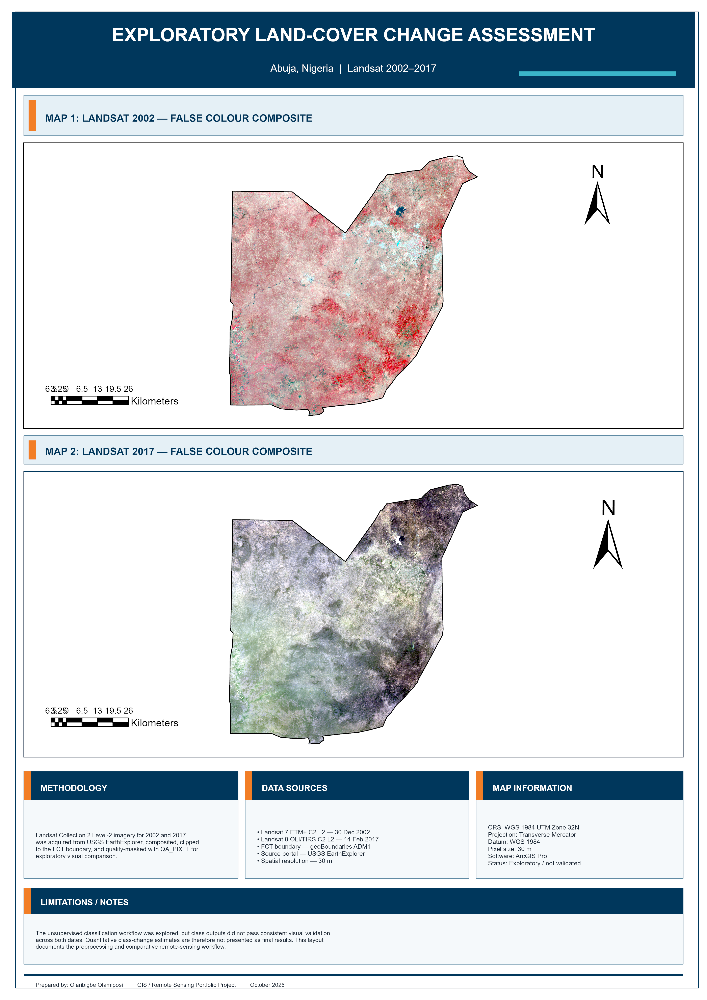

# Exploratory Land-Cover Change Assessment — Abuja, Nigeria (2002–2017)

## Project Overview

This project explores land-cover change in the Federal Capital Territory (FCT), Abuja, Nigeria, using Landsat satellite imagery from 2002 and 2017.

The project was developed in ArcGIS Pro as a remote-sensing and GIS portfolio exercise. The workflow focused on satellite-image acquisition, preprocessing, quality masking, spatial clipping, raster classification experimentation, change-detection logic, visual validation, and professional cartographic presentation.

The final portfolio output presents comparable false-colour Landsat imagery for the two study years.

## Study Area

The study area is the Federal Capital Territory (FCT), Abuja, Nigeria.

All raster processing was carried out using:

- Coordinate System: WGS 1984 UTM Zone 32N
- Projection: Transverse Mercator
- Datum: WGS 1984
- Spatial Resolution: approximately 30 m

## Data Sources

### Landsat 2002

Landsat 7 ETM+ Collection 2 Level-2 surface reflectance imagery was obtained from the USGS EarthExplorer platform.

Scene used:

- Path: 189
- Row: 054
- Acquisition year: 2002

### Landsat 2017

Landsat 8 OLI/TIRS Collection 2 Level-2 surface reflectance imagery was obtained from USGS EarthExplorer.

Scene used:

- Path: 189
- Row: 054
- Acquisition year: 2017

### Administrative Boundary

The Federal Capital Territory boundary was derived from Nigeria administrative-boundary data and projected to WGS 1984 UTM Zone 32N.

## Processing Workflow

The main GIS and remote-sensing workflow included:

1. Defining the Federal Capital Territory study area.
2. Downloading Landsat Collection 2 Level-2 imagery.
3. Organizing imagery by acquisition year.
4. Creating multiband Landsat composites.
5. Projecting spatial data to WGS 1984 UTM Zone 32N.
6. Clipping imagery to the FCT study boundary.
7. Processing QA_PIXEL data for image-quality masking.
8. Producing cleaned 2002 and 2017 Landsat datasets.
9. Creating false-colour composites for visual interpretation.
10. Exploring supervised and unsupervised classification methods.
11. Creating ISO Cluster classifications as part of classification experimentation.
12. Testing raster reclassification and land-cover transition analysis.
13. Performing visual validation of the classification outputs.
14. Designing an A3 portrait cartographic layout in ArcGIS Pro.

## False-Colour Imagery

The final comparison maps use false-colour Landsat composites to improve visual interpretation of vegetation, built surfaces, water bodies, and other land-cover patterns.

### 2002 Composite

The Landsat 7 composite uses:

- Red: Band 4
- Green: Band 3
- Blue: Band 2

### 2017 Composite

The processed Landsat 8 composite was displayed using its prepared RGB band configuration for comparison with the 2002 imagery.

## Classification Experiment

A land-cover classification workflow was explored using four general classes:

- Built-up
- Vegetation
- Bare land
- Water

Both training-based and ISO Cluster unsupervised classification approaches were investigated.

The ISO Cluster workflow generated spectral clusters that were interpreted and reclassified into the four land-cover categories. Raster Calculator was also used to test transition coding between the 2002 and 2017 classified datasets.

## Validation and Limitations

Visual validation showed that the automated land-cover classifications were not sufficiently consistent across both years.

In particular, spectral confusion was observed between built-up areas, bare surfaces, and some vegetation classes. The resulting quantitative land-cover change statistics were therefore not treated as validated final results.

For this reason, the final portfolio layout emphasizes the processed and spatially comparable Landsat imagery rather than presenting uncertain classification statistics as definitive land-cover change measurements.

A more rigorous operational study would require:

- Additional training and validation samples
- Independent reference data
- Accuracy assessment and confusion matrices
- Improved atmospheric and cloud-quality control
- Spectral-index-assisted classification
- Consistent classification methodology across both dates
- Ground-truth or high-resolution validation imagery

## Final Output

The project concludes with an A3 portrait GIS layout showing:

- Landsat 2002 false-colour imagery
- Landsat 2017 false-colour imagery
- Federal Capital Territory boundary
- Methodology
- Data sources
- Map information
- Study limitations

The final layout is available as both PNG and PDF.

## Key Project Files

### Final Map

`Exploratory_LandCover_Change_Abuja_2002_2017.png`

High-resolution image of the final A3 portfolio layout.

### PDF Layout

`Exploratory_LandCover_Change_Abuja_2002_2017.pdf`

PDF version of the final map layout.

### ArcGIS Pro Layout

`Exploratory_LandCover_Change_Abuja_A3_Portrait.pagx`

Reusable ArcGIS Pro A3 portrait layout file.

### ArcGIS Pro Project

`Urban_Growth_Land_Cover_Change_Abuja.aprx`

Main ArcGIS Pro project file.

The raw Landsat imagery is not included in this repository because of file size. Source imagery can be obtained from USGS EarthExplorer.

## GIS and Remote-Sensing Skills Demonstrated

- ArcGIS Pro
- Landsat satellite imagery
- Raster data management
- Multiband composite creation
- False-colour imagery
- QA_PIXEL processing
- Raster masking
- Raster clipping
- Coordinate-system management
- Supervised classification experimentation
- ISO Cluster unsupervised classification
- Raster reclassification
- Raster Calculator
- Change-detection logic
- Visual accuracy assessment
- Cartographic layout design
- GIS project documentation

## Software

- ArcGIS Pro
- USGS EarthExplorer
- GitHub

## Project Status

Completed as an exploratory GIS and remote-sensing portfolio project.

The project demonstrates both technical image-processing skills and the importance of validating analytical results before presenting them as reliable geographic conclusions.

## Author

**Olaribigbe Olamiposi**

GIS / Geospatial Analysis Portfolio Project  
Abuja, Nigeria
